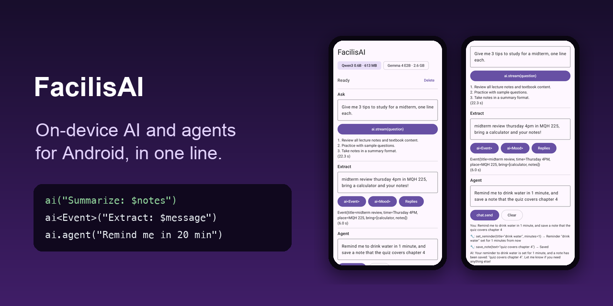

# FacilisAI

[](https://jitpack.io/#al3j4ndrolm/FacilisAI)
[](https://github.com/al3j4ndrolm/FacilisAI/actions/workflows/build.yml)
[](LICENSE)

**On-device AI and agents for Android in one line.** Offline, private, free. No API keys, no server.

<p align="center">
  
</p>

Part of the Facilis family, with [FacilisCam](https://github.com/al3j4ndrolm/FacilisCam), [FacilisStorage](https://github.com/al3j4ndrolm/FacilisStorage), [FacilisPermission](https://github.com/al3j4ndrolm/FacilisPermission) and [FacilisNotification](https://github.com/al3j4ndrolm/FacilisNotification).

```kotlin
val summary = ai("Summarize this in 3 bullet points: $notes")
```

Works from an Activity, a ViewModel or background work. No `Context`, no `init()`. The model downloads itself the first time.

## Typed answers

```kotlin
@Serializable data class Event(val title: String, val time: String, val place: String?)

val event = ai<Event>("Extract the event: $message")
// Event(title=Midterm review, time=Thursday 4pm, place=MQH 225)
```

You get an object, not text to parse. The answer is checked against your class, and if it doesn't fit, the model is asked again with its output constrained to your class's shape. Works with classes, enums (`ai<Mood>(...)`), lists (`ai<List<String>>("Suggest 3 replies...")`), strings and numbers.

## Agents: give it tools

```kotlin
@Serializable data class Reminder(val title: String, val minutes: Int)

ai.tool<Reminder>("set_reminder", "Remind the user later") { r ->
    notify.after(r.minutes.minutes, r.title)        // FacilisNotification
    "Reminder set"
}

ai.agent("Remind me to call mom in 20 minutes")
```

The model decides when to call a tool, FacilisAI runs it and hands the result back, and the model continues until it can answer. Arguments come from your `@Serializable` class: no JSON schemas by hand. Add `@Describe("...")` to a field to explain it.

Tools that delete, send or spend should ask first: `ai.tool(..., confirm = true)` shows the user a dialog before it runs. Plain `ai(...)` never uses tools, so questions get plain answers.

## Chat

```kotlin
val chat = ai.chat(system = "You are a study buddy")      // uses your tools too
chat.send("Quiz me on CS 149")
chat.send("Harder")

val messages by chat.messages.collectAsState()   // live, including tools that ran
```

## Stream

```kotlin
ai.stream("Write a haiku about finals").collect { text += it }
```

## Photos

```kotlin
ai.model = Model.Gemma4

camera.open { photo ->                              // FacilisCam
    val answer = ai("What can I cook with this?", image = photo.uri)
}
```

## The model

| | Download | Images | Good for |
|---|---|---|---|
| `Model.Qwen3` (default) | 600 MB | | Extraction, classification, short answers, a few tools |
| `Model.Gemma4` | 2.6 GB | ✓ | Writing (replies, rewrites), better tool use, photos |
| `Model.url(...)` | yours | | Any `.litertlm` model you host |

Measured on a Pixel 8a (GPU):

| | Qwen3 | Gemma4 |
|---|---|---|
| First load after download | 22 s | 37 s |
| Later loads | 3 s | 4 s |
| `ai<Event>(...)` from a sentence | 6 s | 8 s |
| `ai.agent(...)` with 2 tool calls | 9 s | 6 s |
| Photo of a whiteboard → `ai<Event>` | | 15 s |

The model isn't in your APK: it downloads once into your app's private storage. Show progress and let users choose when:

```kotlin
val state by ai.state.collectAsState()
when (val s = state) {
    is AiState.Downloading -> LinearProgressIndicator({ s.progress })
    AiState.NotDownloaded -> Button({ scope.launch { ai.download(wifiOnly = true) } }) { Text("Download (${ai.model.size})") }
    else -> {}
}
```

Downloads resume where they stopped and are checked against a checksum. `ai.deleteModel()` frees the space; `ai.prepare()` loads it ahead of time so the first answer is quick. The model is freed from memory after 5 idle minutes (`ai.keepLoaded`) or when Android runs low.

## Install

Add JitPack to `settings.gradle.kts`:

```kotlin
dependencyResolutionManagement {
    repositories {
        google()
        mavenCentral()
        maven("https://jitpack.io")
    }
}
```

Then (min SDK 26, Kotlin 2.3+ with the serialization plugin for typed answers and tools):

```kotlin
plugins {
    id("org.jetbrains.kotlin.plugin.serialization") version "<your Kotlin version>"
}

dependencies {
    implementation("com.github.al3j4ndrolm:FacilisAI:1.0.0")
}
```

No manifest changes: the internet permission and GPU libraries are merged in for you.

## Good to know

- **Built on** Google's [LiteRT-LM](https://github.com/google-ai-edge/LiteRT-LM). It runs on the GPU when it can and falls back to the CPU.
- **App size:** the LiteRT-LM runtime adds about 22 MB to the installed app (Google Play delivers only the phone's CPU type, compressed). The model downloads separately.
- **Phones:** realistic on phones with 6 GB+ of RAM. Emulators work but are very slow.
- **Small models make things up.** Great at turning text into structure, sorting and using a few tools; not a source of facts or math. Keep tools to about 5 with clear descriptions, and check what `ai.agent` did (`chat.messages` lists every tool call).
- **Models** are Apache 2.0 and downloaded from Hugging Face. For production, consider hosting the file yourself and using `Model.url(...)`.

## Contributing

```bash
./gradlew :ai:testDebugUnitTest :ai:assembleRelease :sample:assembleDebug
```

`ai/` is the library and `sample/` a demo app that uses FacilisNotification and FacilisStorage as tools.

## License

[MIT](LICENSE)
